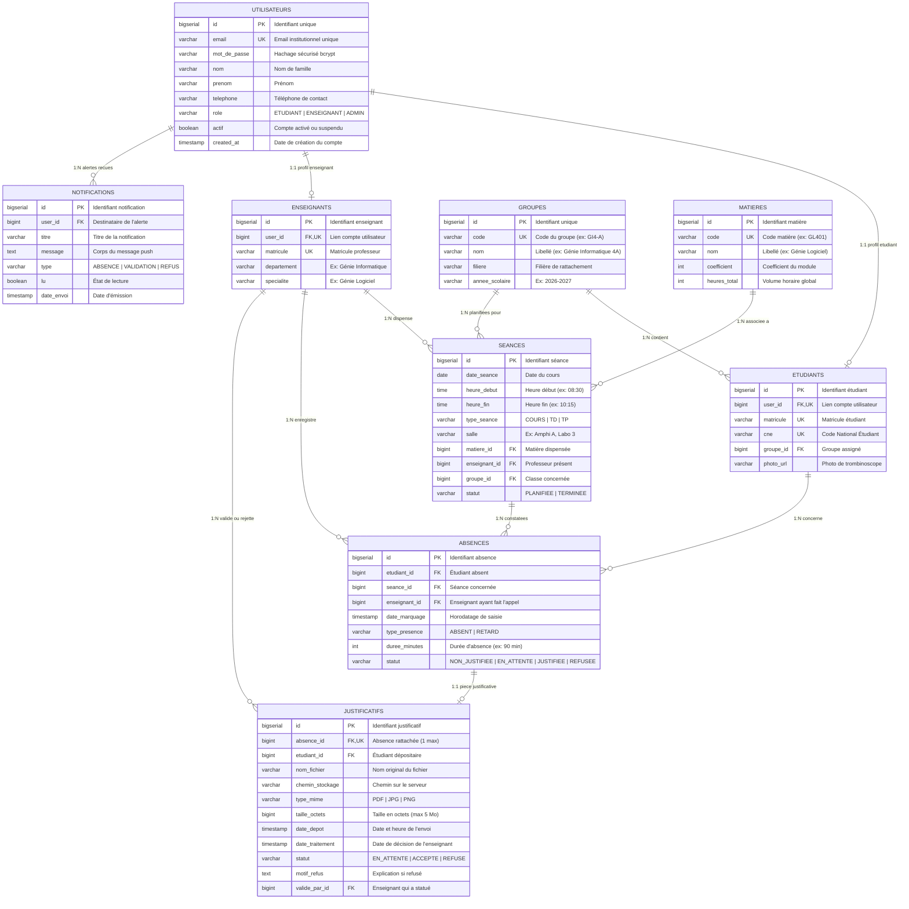

# 🗄️ Schéma Relationnel Détaillé de la Base de Données (Neon PostgreSQL)

Ce document décrit l'ensemble des tables, colonnes, contraintes d'intégrité et relations pour l'application **Absence App**.

---

##  Diagramme Entité-Relation (Mermaid ERD)

---

## 🔒 Règles de Gestion & Contraintes Métier

1. **Anti-doublon d'absence (US03) :**
   * Contrainte UNIQUE : `UNIQUE(etudiant_id, seance_id)`
   * Un enseignant ne peut jamais enregistrer deux fois le même étudiant absent lors de la même séance.
2. **Intégrité des justificatifs (US06) :**
   * Contrainte UNIQUE : `UNIQUE(absence_id)`
   * Une absence ne possède qu'un seul justificatif à la fois.
   * Contrainte de taille : `taille_octets <= 5242880` (5 Mo maximum).
3. **Unicité des accès (US01 & US13) :**
   * Contrainte UNIQUE sur `utilisateurs(email)`.
   * Contrainte UNIQUE sur `etudiants(cne)` et `etudiants(matricule)`.
