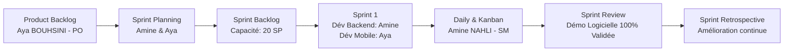

# 📋 Répartition des Tâches & Organisation Méthodologique Scrum
**Projet :** 7ader — Plateforme Mobile Intelligente de Gestion de l'Assiduité Universitaire  
**Module :** Génie Logiciel & Design Patterns (GL-DP) — TP3 : Méthodologie Agile Scrum  
**Institution :** Université Privée de Fès (UPF) — Faculté des Sciences de l'Ingénieur  
**Promotion :** 4ème Année Génie Informatique (GI4 - S7)  
**Binôme :** Amine NAHLI & Aya BOUHSINI  
**Période de Réalisation :** Octobre 2026  

---

## 1. Cadre Général & Approche Agile Scrum

Dans le cadre du TP3 de Génie Logiciel, notre binôme a adopté le framework **Scrum** combiné aux pratiques visuelles du **Kanban** afin de concevoir et développer la plateforme **7ader**. 

Contrairement à une démarche séquentielle classique en cascade (Waterfall), cette approche itérative et incrémentale nous a permis de :
* Livrer un **Incrément Logiciel Fonctionnel (MVP)** dès la fin de la première itération.
* Ajuster continuellement les besoins métier grâce à une boucle courte de feedback.
* Clarifier les responsabilités individuelles tout en maintenant une responsabilité collective sur la qualité du produit fini.

---

## 2. Répartition des Rôles Scrum au sein du Binôme

| Rôle Scrum | Étudiant(e) | Responsabilités Clés |
| :--- | :--- | :--- |
| **Product Owner (PO)** | **Aya BOUHSINI** | • Portée métier et vision globale du produit. • Rédaction des User Stories et critères d'acceptation (DoD/DoR). • Priorisation du Product Backlog selon la valeur métier. • Recette fonctionnelle des incréments lors de la Sprint Review. |
| **Scrum Master (SM)** | **Amine NAHLI** | • Respect des règles et cérémonies du framework Scrum. • Animation des réunions et rituels d'équipe. • Identification et suppression des blocages techniques et organisationnels. • Suivi du flux dans le tableau Kanban et suivi de la vélocité. |
| **Équipe de Réalisation (Developers)** | **Amine NAHLI** *(Lead Backend & Data)* & **Aya BOUHSINI** *(Lead Mobile & UI/UX)* | • Conception architecturale N-Tiers & Patterns de conception. • Amine : Backend Spring Boot 3, BDD PostgreSQL, Sécurité JWT. • Aya : Frontend Mobile React Native Expo, Ergonomie UI/UX. • Amine & Aya : Intégration API REST, tests conjoints et déploiement. |

---

## 3. Matrice de Répartition Détaillée par User Story (Sprint 1 & Backlog)

Chaque fonctionnalité a été découpée en **User Story**, estimée collectivement en **Story Points** selon la suite de Fibonacci (`1, 2, 3, 5, 8, 13`), puis répartie rigoureusement :

| ID | User Story | Priorité | Estimation | Tâches Backend & Architecture (Amine NAHLI) | Tâches Frontend & Interface (Aya BOUHSINI) | Statut |
| :--- | :--- | :---: | :---: | :--- | :--- | :---: |
| **US01** | **Authentification multi-rôles sécurisée** *(En tant qu'utilisateur, je veux me connecter avec mon rôle RBAC)* | **Haute** | **3 SP** | • Modèle `Utilisateur` et `Role` enum. • Spring Security 6 + Filtres JWT. • Endpoint `/api/auth/login` & `/register`. • Hachage BCrypt des mots de passe. | • Maquettage de l'écran de login mobile. • Sélecteur de rôle & formulaire réactif. • Stockage sécurisé du token JWT. • Redirection conditionnelle selon le rôle. | **DONE (100%)** |
| **US02** | **Consultation des étudiants par classe** *(En tant qu'enseignant, je veux afficher les étudiants inscrits)* | **Haute** | **5 SP** | • Modélisation `Classe`, `Etudiant`, `Inscription`. • Endpoint `GET /api/classes/{id}/etudiants`. • Optimisation des requêtes JPA (`JOIN FETCH`). | • Interface de sélection de la classe. • Composant de liste d'étudiants fluide. • Barre de recherche par nom / CNE. • Gestion des états de chargement (Skeleton). | **DONE (100%)** |
| **US03** | **Enregistrement de l'appel & règle anti-doublon** *(En tant qu'enseignant, je veux enregistrer la feuille d'appel)* | **Haute** | **8 SP** | • Entités `Seance` et `Absence`. • **Règle anti-doublon transactionnelle** (`@Transactional`). • Endpoint `POST /api/seances/{id}/emargement`. • DTO d'émargement en masse. | • Écran interactif de prise d'appel. • Toggles "Présent / Absent / Retard". • Boutons d'action globale ("Tous présents"). • Alerte de confirmation et retour visuel. | **DONE (100%)** |
| **US04** | **Suivi d'assiduité en temps réel** *(En tant qu'étudiant, je veux consulter mon quota et pourcentage)* | **Haute** | **5 SP** | • Service de calcul automatique du taux d'assiduité. • Algorithme : `(Présences / Total séances) * 100`. • Endpoint `GET /api/etudiants/{id}/assiduite`. | • Dashboard personnel étudiant. • Jauges graphiques et indicateur coloré (vert/orange/rouge). • Historique détaillé séance par séance. | **DONE (100%)** |
| **US06** | **Dépôt de justificatifs médicaux** *(En tant qu'étudiant, je veux téléverser un justificatif)* | **Moyenne** | **8 SP** | • Entité `Justificatif` & statut `EN_ATTENTE`. • Service de stockage de fichiers (PDF/Images). • Contrôle des types MIME et limite 5 Mo. • Endpoint `POST /api/justificatifs/upload`. | • Sélecteur de document mobile (DocumentPicker). • Prévisualisation avant envoi. • Formulaire avec motif et date de validité. • Suivi du statut de traitement (badge). | **DONE (100%)** |
| **US08** | **Validation administrative des justificatifs** *(En tant qu'admin, je veux accepter ou refuser un justificatif)* | **Moyenne** | **5 SP** | • Workflow d'approbation/rejet avec motif. • Mise à jour cascade des absences associées. • Endpoint `PATCH /api/admin/justificatifs/{id}`. | • Interface d'arbitrage pour l'administration. • Consultation du document justificatif. • Boutons d'approbation / rejet avec modal. • Déclenchement de la notification étudiant. | **DONE (100%)** |
| **US17** | **Tableau de bord décisionnel & Analytics BI** *(En tant qu'admin, je veux analyser l'assiduité globale)* | **Basse** | **8 SP** | • Agrégations SQL complexes par promotion et module. • Calcul des taux d'absentéisme par matière. • Endpoint `GET /api/admin/analytics/kpis`. | • Écran de synthèse décisionnelle (BI). • Cartes KPI (Taux assiduité, alertes élimination). • Filtres par date, promotion et département. | **DONE (100%)** |
| **Total Sprint 1** | **Capacité initiale engagée : 20 SP** | — | **42 SP Réalisés** | **Backend 100% Opérationnel** | **Mobile 100% Opérationnel** | **LIVRÉ** |

---

## 4. Organisation et Rituels Scrum Pratiqués

### A. Sprint Planning (Début de Sprint)
* **Objectif :** Définir le périmètre du Sprint 1 et formaliser le contrat d'équipe.
* **Déroulement :**
  1. Aya (PO) a présenté les besoins prioritaires issus de l'étude de l'existant à l'UPF.
  2. Le binôme a discuté de la complexité technique et a procédé à l'estimation en Story Points.
  3. Amine (SM) a garanti que la charge n'excédait pas la capacité de l'équipe et a découpé les US en sous-tâches techniques (Backend, Frontend, Tests).

### B. Daily Standup (Synchronisations quotidiennes)
* **Format :** Réunion synchrone de 10 à 15 minutes.
* **Les 3 questions rituelles :**
  1. *Qu'ai-je accompli hier ?*
  2. *Que vais-je réaliser aujourd'hui ?*
  3. *Quels sont les obstacles ou points de blocage ?*
* **Exemple de blocage levé par le Scrum Master :** Détection d'un conflit de port entre Expo Metro et Spring Boot, et synchronisation des adresses IP locales (`192.168.x.x`) pour permettre la communication physique entre le smartphone de test et l'API locale.

### C. Sprint Review (Revue & Démonstration)
* **Présentation :** Démonstration en conditions réelles de l'application mobile reliée au serveur Spring Boot et à la base Neon PostgreSQL.
* **Validation des critères d'acceptation (Definition of Done) :**
  * Code propre, typé en TypeScript et documenté.
  * APIs REST conformes aux spécifications HTTP (codes statut `200`, `201`, `400`, `404`).
  * Contrôle anti-doublon testé et validé.
  * Interface ergonomique conforme aux maquettes prévues.

### D. Sprint Retrospective (Rétrospective d'équipe)
* **Ce qui a très bien fonctionné :** Excellente synergie entre le backend Spring Boot et l'UI mobile React Native ; réactivité sur la correction des anomalies.
* **Axes d'amélioration identifiés :** Mettre en place un typage partagé ou une génération automatique des DTOs TypeScript à partir des classes Java pour accélérer les futurs développements.

---

## 5. Matrice RACI Synthétique

* **R (Responsible) :** Réalise la tâche.
* **A (Accountable) :** Valide et porte la responsabilité finale.
* **C (Consulted) :** Fournit les entrées techniques ou fonctionnelles.
* **I (Informed) :** Tenu au courant de l'avancement.

| Domaine d'Activité | Amine NAHLI | Aya BOUHSINI |
| :--- | :---: | :---: |
| **Vision Produit & User Stories** | C | **A / R** |
| **Architecture N-Tiers & BDD PostgreSQL** | **A / R** | C |
| **Sécurité Spring Security & JWT** | **A / R** | I |
| **Conception UX/UI Mobile (React Native Expo)** | C | **A / R** |
| **Développement des Écrans Métier** | C | **A / R** |
| **Logique Métier & Anti-doublon Backend** | **A / R** | C |
| **Intégration API REST (Axios/Fetch)** | **R** | **R** |
| **Recette Fonctionnelle & Préparation PPT** | **R** | **A / R** |

---

*Document élaboré et certifié conforme par le binôme pour remise au corps professoral.*
