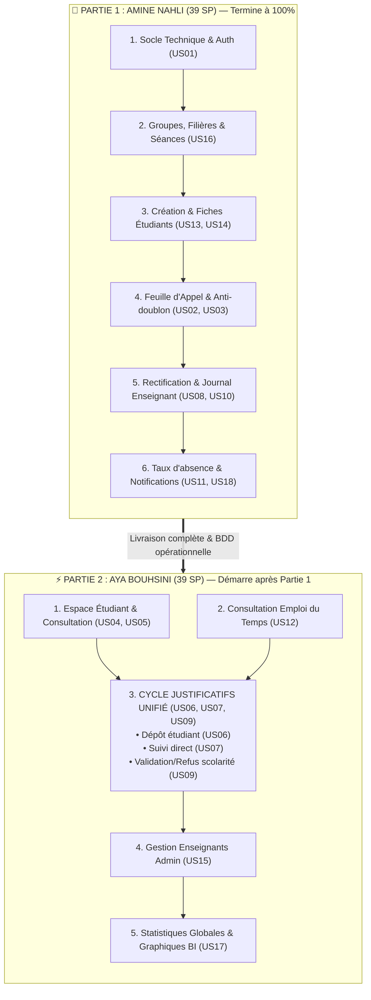

# 📊 Nouvelle Répartition Séquentielle des User Stories (Amine & Aya)

> **Projet PFA :** Système Mobile & Web de Gestion des Absences & Justificatifs (UPF)  
> **Méthodologie :** Découpage Séquentiel par Phase (Zéro Dépendance Circulaire)  
> **Total Général :** 78 Story Points (39 SP Amine + 39 SP Aya)

---

## 💡 Pourquoi ce Nouveau Découpage ? (Résolution du Problème)

### ❌ Ancien Découpage (Problème de Dépendance Circulaire)
Dans l'ancien découpage :
* Amine devait faire **US09** (*Validation du justificatif*), tandis qu'Aya devait faire **US06** (*Dépôt du justificatif*).
* **Conséquence :** Amine ne pouvait pas tester ni terminer sa partie sans attendre qu'Aya ait fini son upload. Il y avait des allers-retours permanents : « *Amine fait un peu, puis attend Aya, puis Amine reprend...* ».

### ✅ Nouveau Découpage Séquentiel (Partie 1 d'abord, puis Partie 2)
1. **Partie 1 (Amine) — 100% Autonome :**
   * Amine construit le socle technique, la gestion des étudiants et groupes, et **toute la chaîne d'émargement de A à Z** (Appel, anti-doublon, rectification, calcul des taux, notifications).
   * **Amine termine et livre l'intégralité de la Partie 1 sans avoir besoin d'Aya.**
2. **Partie 2 (Aya) — Démarre sur une base terminée :**
   * Aya commence une fois la Partie 1 livrée.
   * Aya détient **100% du cycle des justificatifs** : le dépôt par l'étudiant (**US06**), le suivi en direct (**US07**) ET la validation/décision avec motif (**US09**).
   * Aya développe également le portail étudiant (**US04**, **US05**, **US12**) et le tableau de bord décisionnel global (**US17**).
   * **Amine n'a plus jamais besoin d'intervenir pour qu'Aya termine.**

---

## 🔄 Diagramme de Flux Séquentiel

---

## 📋 Tableau Récapitulatif Comparatif (Équilibre Strict 39 SP / 39 SP)

| Membre | Rôle & Périmètre | User Stories Assignées | Total SP |
| :--- | :--- | :--- | :---: |
| **Amine NAHLI** *(Partie 1)* | **Socle, Authentification & Cœur Émargement** • Gestion des groupes, séances et étudiants • Prise d'appel en temps réel & blocage de doublon • Rectification, journal prof & alertes taux | **US01** (3 SP) + **US02** (3 SP) + **US03** (5 SP) + **US08** (3 SP) + **US10** (5 SP) + **US11** (5 SP) + **US13** (3 SP) + **US14** (2 SP) + **US16** (5 SP) + **US18** (5 SP) | **39 SP** |
| **Aya BOUHSINI** *(Partie 2)* | **Portail Étudiant, Cycle Justificatifs & Décisionnel** • Consultation absences & emploi du temps étudiant • Cycle complet justificatif (Upload, Suivi, Validation) • Pilotage administratif & graphiques globaux | **US04** (5 SP) + **US05** (2 SP) + **US06** (8 SP) + **US07** (3 SP) + **US09** (5 SP) + **US12** (5 SP) + **US15** (3 SP) + **US17** (8 SP) | **39 SP** |
| **TOTAL GÉNÉRAL** | **Couverture intégrale du projet** | **18 User Stories** | **78 SP** |
