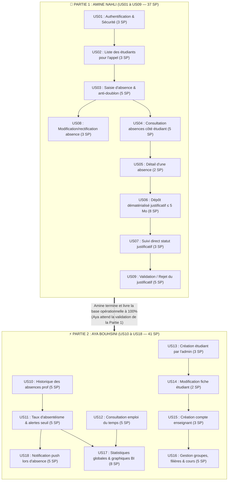

# 📊 Découpage Séquentiel Strict : US01-US09 (Amine) puis US10-US18 (Aya)

> **Projet PFA :** Système Mobile & Web de Gestion des Absences & Justificatifs (UPF)  
> **Principe Séquentiel Absolu :** Amine réalise et termine intégralement la **Partie 1 (US01 à US09)**. Une fois terminé, Aya prend le relais et réalise la **Partie 2 (US10 à US18)**.  
> **Volume Global :** 78 Story Points (37 SP Amine + 41 SP Aya)

---

## 🎯 Pourquoi ce Découpage (US01-US09 puis US10-US18) ?

1. **Partie 1 (Amine : US01 à US09) = Le Cœur Opérationnel des Absences & Justificatifs :**
   * Amine met en place toute la fondation (Auth, BDD, Prise d'appel prof, anti-doublon, modification).
   * Amine gère également toute la chaîne opérationnelle de base pour l'étudiant et le justificatif (consultation des absences, dépôt de pièce justificative, suivi et arbitrage/validation par le prof ou l'admin).
   * **Amine termine à 100% et livre l'application avec un cycle complet d'absence fonctionnel.**

2. **Partie 2 (Aya : US10 à US18) = Analytics, Administration Globale, Emploi du temps & Notifications :**
   * Aya n'intervient qu'une fois la Partie 1 livrée.
   * Elle peut exploiter directement les vraies données d'absences saisies pour générer les historiques (**US10**), calculer les taux d'absentéisme et alertes (**US11**), et construire les graphiques décisionnels BI de la direction (**US17**).
   * Elle complète l'application avec l'emploi du temps (**US12**), la gestion administrative globale des comptes et filières (**US13, US14, US15, US16**) et les alertes push (**US18**).
   * **Zéro allers-retours, zéro blocage.**

---

## 🔄 Diagramme de Flux Séquentiel

---

## 📋 Tableau Récapitulatif Complet

| Phase | Responsable | User Stories Prises en Charge | Détail des SP | Total SP |
| :---: | :---: | :--- | :---: | :---: |
| **Partie 1** *(En premier)* | **Amine NAHLI** | • **US01** : Authentification & Sécurité • **US02** : Liste des étudiants pour l'appel • **US03** : Enregistrement absence avec anti-doublon • **US04** : Consultation absences côté étudiant • **US05** : Détail d'une absence • **US06** : Dépôt justificatif dématérialisé • **US07** : Suivi statut justificatif • **US08** : Rectification d'absence • **US09** : Validation / Rejet du justificatif | 3 + 3 + 5 + 5 + 2 + 8 + 3 + 3 + 5 | **37 SP** |
| **Partie 2** *(Après Amine)* | **Aya BOUHSINI** | • **US10** : Historique absences enseignant • **US11** : Taux absentéisme & alertes seuil • **US12** : Consultation emploi du temps • **US13** : Création d'étudiant par l'admin • **US14** : Modification fiche étudiant • **US15** : Création compte enseignant • **US16** : Gestion groupes & affectations • **US17** : Statistiques globales & graphiques BI • **US18** : Notification push absence | 5 + 5 + 5 + 3 + 2 + 3 + 5 + 8 + 5 | **41 SP** |
| **TOTAL** | **Global Projet** | **US01 à US18 Couverture Intégrale** | — | **78 SP** |
